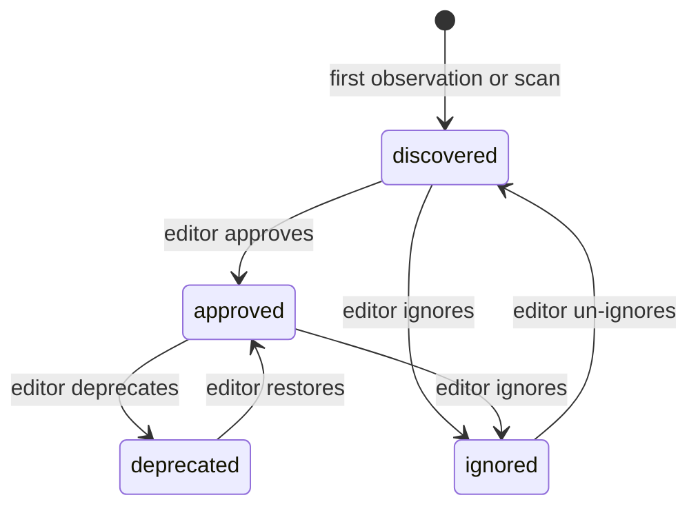
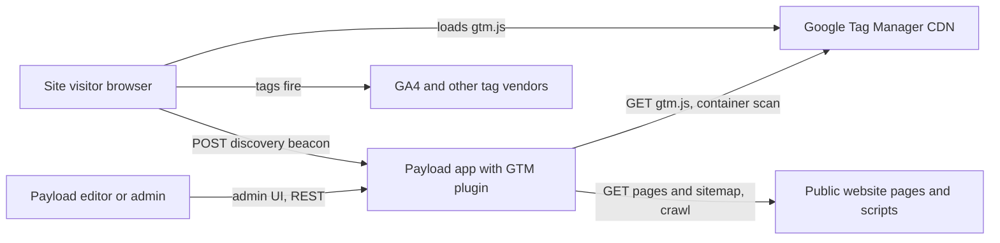
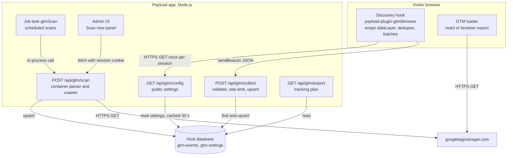
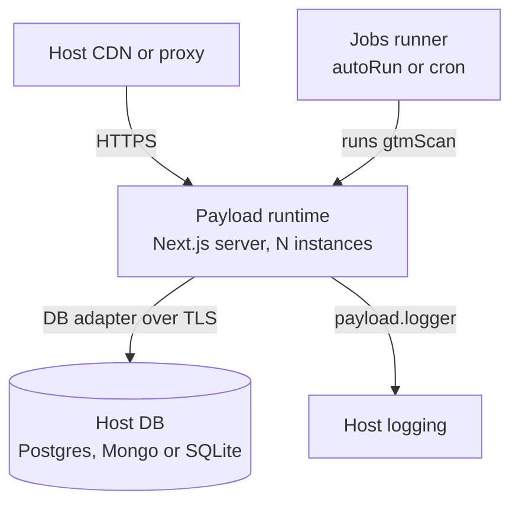
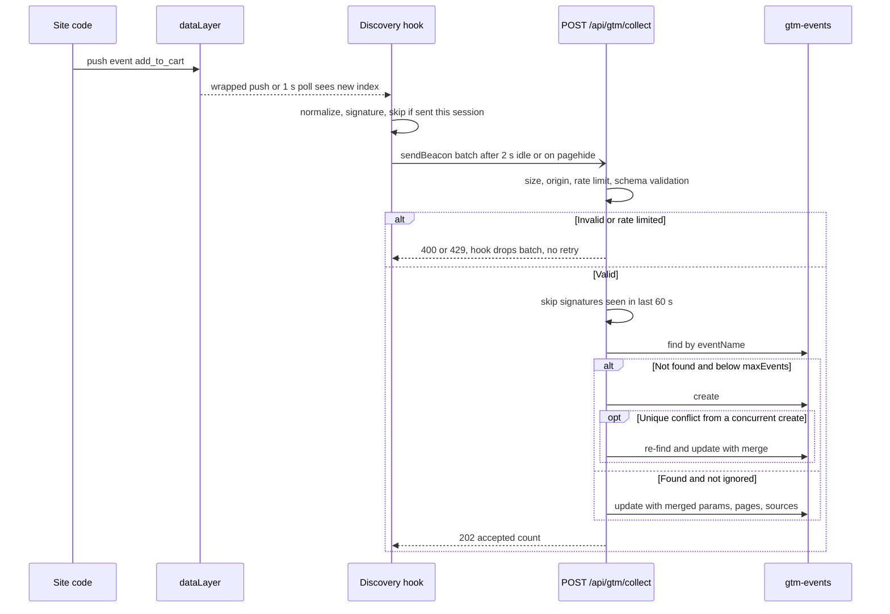
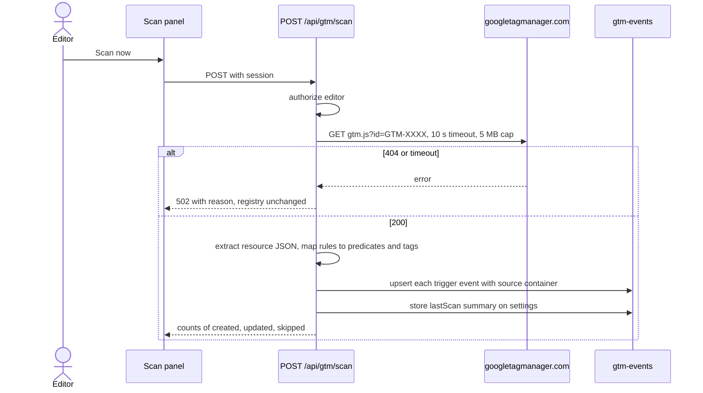
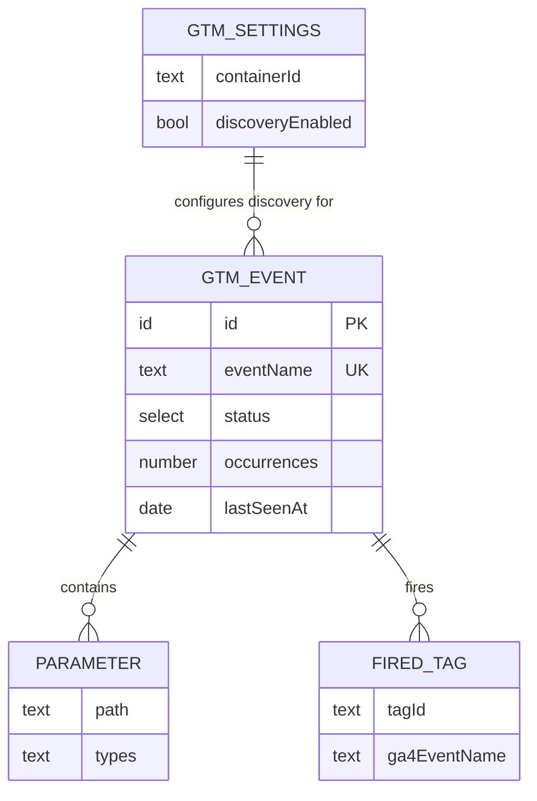

# payload-plugin-gtm — System Design

- **Status:** Draft (implemented as MVP in this repository)
- **Date:** 2026-11-04
- **Owners:** Plugin maintainer
- **Decision horizon:** MVP (v0.1) and the next two minor releases

## 1. Executive Summary

`payload-plugin-gtm` is a Payload CMS v3 plugin that (a) manages a Google Tag Manager (GTM) installation from the Payload admin and (b) **automatically discovers every dataLayer event a website emits** and keeps them in an editable *event registry* (a living tracking plan).

Discovery combines three independent sources, because none is complete on its own:

1. **Runtime capture (browser).** A tiny script hooks `window.dataLayer` (including `gtag('event', …)` calls). It reports each event's name and parameter *shape* (key paths + types, no values by default) to a public Payload endpoint. Events are deduplicated in the browser and on the server.
2. **Container scan (server).** The published `gtm.js` container is fetched from `googletagmanager.com` and parsed. This yields every Custom Event trigger, the GA4 event tags those triggers fire, and the Data Layer Variables the container reads, including events that no visitor has triggered yet.
3. **Page crawl (server).** Same-origin pages, from the configured site URL or its `sitemap.xml`, and their same-origin scripts are fetched. The crawler statically extracts `dataLayer.push({event: …})` and `gtag('event', …)` literals.

The recommended shape is a **single Payload plugin running inside the host Payload app**. It adds one collection, one global, four REST endpoints, one job task, an admin "Scan now" UI, and two framework-agnostic frontend entry points (`/browser` and `/react`). No extra infrastructure is needed. The key tradeoff is that the registry is a **schema catalogue, not an analytics pipeline**. Occurrence counts are approximate by design, so write load stays trivial and visitor data stays out of the CMS.

## 2. Facts, Assumptions, and Open Questions

### Facts

- Payload v3 plugins are functions of the form `(options) => (config) => config`. They must spread existing arrays and chain `onInit`. Admin components are referenced by import-map paths such as `pkg/client#Export` (Payload docs, plugin template v3.92).
- GTM's `gtm.js?id=GTM-XXXX` is public and contains the published container as JSON (`resource.macros`, `resource.tags`, `resource.predicates`, `resource.rules`).
- GTM itself wraps `dataLayer.push`. Every push, whoever made it, lands in the `dataLayer` array.
- `gtag()` pushes an `arguments` object (`['event', name, params]`) onto the same array.

### Assumptions

- A-01: Host sites run on any frontend. Next.js is common, but discovery must not depend on React. *If wrong:* nothing breaks; the React wrapper is optional.
- A-02: Sites have ≤ 500 distinct event names. *If wrong:* the `maxEvents` cap is configurable; beyond about 5k, a dedicated analytics store would be needed (see §29).
- A-03: Parameter **values** are personal data candidates and are not stored by default. *If wrong:* `captureExamples` adds redacted, truncated examples.
- A-04: Traffic is up to about 1M pageviews/day per site. With browser dedupe plus sampling, collect load stays below a few requests per second.
- A-05: A single Payload deployment may run several instances (serverless or containers). In-memory caches and rate limits are therefore per instance.

### Open Questions

- Q-01: Should the plugin also *write* to GTM (create triggers/tags) through the GTM API v2? This needs OAuth/service-account management. Deferred to v0.3. Owner: maintainer.
- Q-02: Is server-side GTM (sGTM) container parsing needed? Its format differs. Deferred until requested.
- Q-03: Should discovery respect a consent signal by default? It currently ships an opt-in `shouldCapture` hook. Owner: integrator per jurisdiction.

## 3. Goals and Non-Goals

### Goals

- Install GTM on a site with one component/function call configured from the Payload admin.
- Discover ≥ 95% of the distinct custom events a site emits within one day of normal traffic, when runtime capture is enabled.
- Discover container-defined events without any traffic, through the container scan.
- Give marketers an editable registry: status (discovered/approved/deprecated/ignored), descriptions, owners, and parameter docs.
- Export the registry as a JSON tracking plan.

### Non-Goals

- Replacing GA4/GTM reporting or counting events precisely.
- Storing raw visitor events, user identifiers, or cookies.
- Managing GTM workspaces or versions (Q-01).
- Consent-management UI (CMPs remain the site's responsibility).

## 4. Users, Roles, and Critical Journeys

### Actors

- **Site visitor (untrusted):** loads pages; their browser sends discovery beacons.
- **Payload editor/marketer (authenticated):** reviews and annotates events, triggers scans.
- **Payload admin (authenticated, privileged):** configures container ID, discovery, and access.
- **Developer/integrator (trusted, code-level):** installs the plugin and frontend snippet and sets plugin options.
- **Google Tag Manager CDN (external):** serves `gtm.js`.

### Critical journeys

1. *Install:* the developer adds the plugin and `<GoogleTagManager />`. The admin enters `GTM-XXXX`. GTM loads on the site.
2. *Runtime discovery:* a visitor triggers `add_to_cart`. The event appears in the registry within seconds with its parameter schema (`ecommerce.items[].item_id: string`, and so on).
3. *Container scan:* an editor clicks "Scan now". All Custom Event triggers and their GA4 tags appear, including ones never fired.
4. *Curate:* the editor marks events approved/ignored and documents them. Ignored events stop being re-reported.
5. *Export:* a developer downloads `/api/gtm/export` as the tracking plan.

## 5. Functional Requirements

- **FR-01 (Must):** Inject the GTM snippet (script + noscript iframe) with an optional environment (`gtm_auth`/`gtm_preview`) and a custom dataLayer name.
- **FR-02 (Must):** Capture every `dataLayer` entry with an `event` key and every `gtag('event', …)` call, including entries pushed before the hook loaded.
- **FR-03 (Must):** Flatten parameters into key paths with types; arrays become `path[]`; depth and key count are capped.
- **FR-04 (Must):** Upsert events into the registry by unique `eventName`, merging sources, parameters, pages, and timestamps.
- **FR-05 (Must):** Scan the published GTM container for Custom Event triggers (exact, regex, prefix, contains), the tags they fire, and Data Layer Variables.
- **FR-06 (Should):** Crawl same-origin pages/sitemap and their scripts for event literals.
- **FR-07 (Must):** Provide a public config endpoint so frontends can read the container ID and discovery settings.
- **FR-08 (Should):** Provide an admin "Scan now" control and a JSON export.
- **FR-09 (Should):** Provide a schedulable Payload job task for periodic scans.
- **FR-10 (Must):** Provide an enable/disable option that keeps the schema stable.
- **FR-11 (Later):** Push approved events to GTM as triggers via the GTM API (Q-01).

## 6. Non-Functional Requirements

- **NFR-01:** The browser script adds ≤ 4 KB gzipped, causes no synchronous network on the critical path, and sends via `sendBeacon`/`keepalive`.
- **NFR-02:** The `/gtm/collect` p95 is < 150 ms at the base scenario. Writes are skipped for signatures seen in the last 60 s on that instance.
- **NFR-03:** Discovery failure never breaks the host site or GTM. All browser code is wrapped in try/catch and fails silently.
- **NFR-04:** A container scan completes in < 10 s (one fetch, 10 s timeout). A crawl of ≤ 25 pages completes in < 60 s.
- **SEC-01:** The collect endpoint enforces a body-size cap (32 KB), a batch cap (50 events), name/path allow-lists, a per-IP token bucket, an origin allow-list, and a total registry cap.
- **SEC-02:** By default no parameter values are stored. When enabled, examples are redacted (emails, phone/long digit runs, tokens) and truncated to 100 chars.
- **SEC-03:** Server fetches go only to `www.googletagmanager.com` or to the configured site origin. Redirects stay same-origin, and every fetch has a timeout and a byte cap.
- **OPS-01:** All plugin logs go through `payload.logger` with a `gtm` prefix and contain no parameter values.

## 7. Scale and Capacity Assumptions

### Inputs

- Pageviews/day: low 10k, base 100k, high 1M.
- dataLayer pushes per pageview: about 20 (including `gtm.*` internals).
- Sessions ≈ pageviews ÷ 2.5. Distinct event signatures per session ≈ 8.
- Sample rate default 1.0. Recommended 0.1 at the high scenario.

### Estimates

```text
Without any dedupe (naive): pushes/s = pageviews × 20 / 86,400
  base: 100k × 20 / 86,400 ≈ 23/s avg, ×5 peak ≈ 115/s  -> unacceptable as DB writes

With per-session browser dedupe (one beacon per pageview that has new signatures, ~1.2 per session):
  collect requests/day ≈ sessions × 1.2 × sampleRate
  base: 40k × 1.2 = 48k/day ≈ 0.56 rps avg, ×5 peak ≈ 2.8 rps
  high: 400k × 1.2 × 0.1 = 48k/day  (same as base thanks to sampling)

DB writes after server dedupe window (60 s per signature per instance):
  ≤ distinct signatures × instances × (86,400 / 60) worst case, in practice ≈ requests with novel data
  base worst case: 200 signatures × 2 instances × 1,440 = 576k/day ≈ 6.7 writes/s -> upper bound;
  realistic (signatures concentrated on ~30 hot events) ≈ 30 × 2 × 1,440 ≈ 1 write/s

Storage: 500 events × ~6 KB (params, pages, tags) ≈ 3 MB. Negligible.
```

Headroom: a single small Payload instance comfortably serves > 50 rps of tiny JSON writes, so the base case runs at about 5% of that.

### Growth triggers

- Collect p95 > 300 ms, or > 20 writes/s sustained → lower the default sample rate, or add a shared (Redis) dedupe cache.
- > 2,000 distinct events → paginated export, plus a registry warning that the dataLayer is likely leaking dynamic names.

## 8. Domain Model and Business Invariants

### Domain boundaries

- **Installation:** owns container ID, environment, and dataLayer name. Global `gtm-settings`.
- **Discovery:** owns observation ingestion and scans. Endpoints `collect` and `scan`, the job task, and the browser hook. It writes only plugin-owned fields.
- **Registry/Curation:** owns editor-facing fields (status, description, owner, notes). Collection `gtm-events`.

### Invariants

- INV-01: `eventName` is unique in the registry. Enforced by a DB unique index; a create conflict is retried as an update.
- INV-02: Discovery never overwrites editor-owned fields (`status`, `description`, `owner`, `notes`). Enforced in the merge function.
- INV-03: Events with `status = ignored` are not updated by runtime capture, and the browser does not re-report them. Enforced server-side; the config endpoint returns the ignore list.
- INV-04: No parameter values are persisted unless `captureExamples` is true, and then only after redaction. Enforced server-side regardless of client input.
- INV-05: The registry never exceeds `maxEvents`. New names beyond the cap are dropped and logged.

### State machines



## 9. Architecture Decision and Alternatives

### Decision drivers

- Zero extra infrastructure for plugin users (FR-10, A-05).
- Coverage of events not yet fired *and* events not configured in GTM (Goals).
- Privacy by default (SEC-02).

### Options considered

#### Option A — In-process plugin, three discovery sources (recommended)

- Benefits: installs with one line; uses the host DB and auth; covers static and runtime events.
- Costs/risks: the public endpoint lives inside the CMS process; dedupe and rate limits are per instance.
- Reversibility: high. The plugin can be disabled without schema change.

#### Option B — GTM API v2 only (read workspace via OAuth)

- Benefits: exact trigger/tag names, including unpublished workspaces.
- Costs/risks: requires a Google Cloud project, OAuth credentials, and secret storage; still misses events pushed by site code that no trigger listens to.
- Reversibility: medium. Planned as an additional source (Q-01).

#### Option C — Headless-browser crawler (Playwright) recording dataLayer

- Benefits: sees runtime events without real traffic.
- Costs/risks: ships Chromium (~150 MB), is unsuitable for serverless, and only sees events on page load (no interactions).
- Reversibility: high, but heavy. Rejected for MVP; static crawl plus runtime capture cover it.

#### Option D — Stream all raw events to an analytics store (BigQuery/ClickHouse)

- Benefits: exact counts and full history.
- Costs/risks: duplicates GA4, raises privacy and cost, and needs infrastructure. Rejected as a non-goal.

### Recommendation

Option A, with Option B as a future additive source. It is the simplest design that meets the coverage and privacy goals without infrastructure.

## 10. System Context Diagram



## 11. Container Diagram



## 12. Deployment Diagram



The plugin inherits the host's deployment. It adds no deployable units.

## 13. Critical Sequence Diagrams

### Runtime discovery



### Container scan



## 14. Component Responsibilities

- **Discovery hook (browser):** wraps `push`, scans array growth every 1 s (resilient to GTM re-wrapping), normalizes, dedupes per session (`sessionStorage`), batches, and beacons. Degraded behavior: any error leaves it silent and does nothing.
- **GTM loader (browser/react):** injects the standard GTM snippet once; idempotent when called twice.
- **Collect endpoint:** the trust boundary. It re-validates everything, enforces caps, and upserts. Degraded behavior: on DB errors it returns 500; the browser does not retry (observations recur naturally).
- **Scan service:** the container parser plus crawler. It is pure parsing functions with injected `fetch`, so it is unit-testable.
- **Registry merge:** a pure function `(existing, observation) → patch` that enforces INV-02 and INV-04.
- **Settings cache:** reads the global with a 30 s TTL and is invalidated by the global's `afterChange` hook (only on that instance).
- **Admin panel:** a client component that calls the scan endpoint and refreshes the list.

## 15. Data Model, Indexes, and Retention

### Entities

#### `gtm-events` (collection, slug configurable)

- Primary key: DB default id.
- Tenant/owner scope: global to the Payload instance. Multi-tenant hosts can add a tenant field through `overrideCollection`.
- Fields/classification:
  - `eventName` (text, unique, indexed): public.
  - `status` (select): editor-owned.
  - `description`, `owner`, `notes`: editor-owned, internal.
  - `sources` (multi-select runtime/container/crawl/manual): plugin-owned.
  - `matchType` (exact/regex/startsWith/contains/endsWith): plugin-owned, from container predicates.
  - `isBuiltIn` (bool, for `gtm.*`): plugin-owned.
  - `parameters` (array: `path`, `types[]`, `example?`, `firstSeenAt`): plugin-owned; examples are personal-data candidates and redacted.
  - `pages` (array of path strings, ≤ 25, query string stripped): plugin-owned.
  - `firesTags` (array: `tagId`, `tagType`, `ga4EventName?`): plugin-owned, from the scan.
  - `occurrences` (number, approximate), `firstSeenAt`, `lastSeenAt`: plugin-owned.
- Constraints: `eventName` 1–100 chars matching `^[\w.:\- /]+$`.
- Access patterns: lookup by `eventName` (collect), list by `lastSeenAt` desc (admin), full list (export).
- Indexes: unique(`eventName`), `lastSeenAt`, `status`.
- State/lifecycle: §8 state machine.
- Retention/deletion: kept until deleted by an editor. Optional `staleAfterDays` marks events not seen for N days as stale; this is a phase 2 job.
- Source of truth: the registry, for documentation. GA4 remains the source of truth for counts.

#### `gtm-settings` (global)

- Fields: `enabled`, `containerId` (`^GTM-[A-Z0-9]{4,12}$`), `environment.auth`, `environment.preview`, `dataLayerName`, `discovery.enabled`, `discovery.sampleRate` (0–1), `discovery.captureExamples`, `discovery.includeBuiltInEvents`, `discovery.allowedOrigins[]`, `crawl.siteUrl`, `crawl.maxPages`, `crawl.useSitemap`, `lastScan` (read-only JSON summary including Data Layer Variables).
- Plugin options provide defaults; the global overrides them at runtime.

### Entity relationships



### Consistency and transactions

Eventual consistency is acceptable. The merge is read-modify-write, so concurrent merges for the same event can lose one parameter union. The next observation re-adds it, which converges because the operation is idempotent (set unions). Occurrence counters are approximate (documented). No cross-document transactions are needed.

## 16. API, Webhook, Event, and File Contracts

### Representative API

```text
GET /api/gtm/config
Actor/permission: public
Response 200: { enabled, containerId, dataLayerName, environment?, discovery: { enabled, sampleRate, endpoint, includeBuiltInEvents, ignore: string[] } }
Cache: Cache-Control public, max-age=60
Errors: never 5xx to the site; returns { enabled:false } on failure

POST /api/gtm/collect
Actor/permission: public (browser beacon, Content-Type text/plain or application/json)
Request: { v: 1, page: "/path", events: [{ name, params: [{ path, type, example? }] }] }  <= 32 KB, <= 50 events, <= 100 params each
Response: 202 { accepted, skipped }   400 invalid   403 origin not allowed   413 too large   429 rate limited   503 discovery disabled
Idempotency: merge is a set-union, so replaying the same batch only bumps approximate counters
Rate limits: token bucket per client IP (default 30 req/min, burst 10), per instance

POST /api/gtm/scan
Actor/permission: authenticated user passing access.scan (default: any logged-in user of admin collection)
Request: { container?: boolean = true, crawl?: boolean = false }
Response 200: { container: { found, created, updated, variables, version }, crawl?: { pages, found, created, updated }, errors: [] }
Errors: 401/403, 409 when a scan is already running on this instance, 502 when upstream fails

GET /api/gtm/export
Actor/permission: authenticated (access.read)
Response 200: { generatedAt, containerId, events: [{ eventName, status, description, parameters, sources, firesTags }] }
```

### Webhooks

Not applicable — the plugin consumes no third-party webhooks.

### Jobs/events

- Task `gtmScan`. Producer: the host's schedule (`scanSchedule` cron option) or a manual queue. Consumer: the Payload jobs runner. Input `{ crawl: boolean }`. Idempotent (upserts). Retries: 2. Timeouts follow the fetch limits in SEC-03. A failure is logged and the output records errors. No dead letter beyond Payload's job record.

### Files

Not applicable — no uploads.

## 17. Authentication, Authorization, and Privacy

- Authentication and session lifecycle: delegated to Payload auth (host users collection).
- Roles/attributes and authorization rules: `access` plugin option overrides read/update/delete/scan. Defaults: authenticated users may read/update/scan; delete is allowed for authenticated users; create happens only through the Local API (`overrideAccess`) after endpoint validation, and `access.create` returns false for REST.
- Tenant isolation: not applicable by default; documented hook via `overrideCollection`.
- Administrative/support controls: settings global update requires authentication; the scan is rate limited by a single-flight lock.
- Data classification and minimization: event names and key paths are internal metadata. Example values are personal-data candidates, off by default and redacted. Page paths have query strings and fragments stripped.
- Encryption and secrets: no secrets are stored. `gtm_auth` is a preview-environment token, not a credential, but it is still only returned by the config endpoint when configured.
- Retention, deletion, export, residency: data lives in the host DB under the host's residency, deleted by editors.
- Audit logging and redaction: scans are logged with counts; collect logs only aggregate counts.

## 18. Threat Model and Abuse Controls

### Trust boundaries and entry points

- Browser → `POST /api/gtm/collect` (public, untrusted input).
- Browser → `GET /api/gtm/config` (public read).
- Admin → `POST /api/gtm/scan` (authenticated; triggers outbound fetches).
- Server → googletagmanager.com and the site origin (untrusted response bodies).

### Threat register

- **T-01 Registry poisoning/spam** (junk names flood the registry). Likelihood medium, impact medium. Controls: name regex, `maxEvents` cap, origin allow-list, per-IP rate limit, ignore status. Detective: log on cap hit. Verification: integration test that rejects invalid names and stops at the cap. Residual: a determined attacker can fill the cap with valid-looking names; editors can bulk-delete.
- **T-02 PII leakage** (emails/IDs in parameter values). Likelihood high if values were stored. Controls: values off by default, redaction plus truncation when on, query strings stripped from pages. Verification: unit tests on the redactor.
- **T-03 SSRF via crawl.** Likelihood low (admin-configured URL). Controls: same-origin only, redirect re-check, protocol http/https only, timeout, byte cap, max pages; the scan requires auth. Verification: unit test rejecting cross-origin URLs.
- **T-04 DoS on collect** (large bodies, high RPS). Controls: 32 KB cap read before parse, batch caps, token bucket, server dedupe window. Verification: tests for 413/429.
- **T-05 Malicious container response** (prototype pollution, huge JSON). Controls: host pinned to `www.googletagmanager.com`, 5 MB cap, `JSON.parse` only (no eval), keys read defensively. Verification: parser tests with malformed input.
- **T-06 Stored XSS through event names in the admin UI.** Controls: name regex, and React escaping in the admin. Verification: test that a `<script>` name is rejected.
- **T-07 Unauthorized registry writes through REST.** Controls: `access.create` false for REST; update restricted by access. Verification: integration test that an anonymous REST create is rejected.

### Abuse controls

- Token bucket per IP; origin allow-list; `maxEvents`; batch/body caps; scan single-flight lock; client-side sampling.

## 19. Reliability, SLOs, and Failure Modes

### SLIs/SLOs

- Site integrity: discovery script errors visible to the site = 0 (wrapped in try/catch). Verified by E2E.
- Collect availability: ≥ 99% non-5xx over 30 days, following the host's availability.
- Scan success: ≥ 95% of scheduled scans succeed over 30 days.

### Dependency failure matrix

- **googletagmanager.com:** 10 s timeout; job retries 2; idempotent upsert; fallback keeps the previous registry and records the error in `lastScan`; the admin sees the error.
- **Site origin (crawl):** 10 s per page; no retry per page; partial results are kept; errors are listed in the response.
- **Host DB:** collect returns 500 and the browser drops the batch (no retry storm); scans fail and are retried by the job.

### Overload and graceful degradation

- Under load: rate limiter returns 429 → the browser stops sending for the session (`backoff` flag in sessionStorage).
- Discovery can be disabled from the global without deploy. The config endpoint then returns `discovery.enabled=false` and the hooks stop.

## 20. Observability and Operations

- Logs and redaction: `payload.logger.info/warn` with `[gtm]` prefix; never log params.
- Metrics and golden signals: the host's request metrics for `/api/gtm/*`; `lastScan.at` / `lastScan.errors` in the settings global.
- Traces/correlation: the host's tracing, if any.
- Dashboards: the admin list sorted by `lastSeenAt`, plus the scan panel's last-scan summary.
- Alerts and runbooks: README covers "No events arriving" (check config endpoint, allowed origins, adblockers) and "Scan fails" (container unpublished, ID typo).
- Ownership/on-call: the host team.
- Reconciliation: a periodic container scan reconciles registry ↔ container; events in the registry but missing from the container are flagged by `sources` lacking `container`.

## 21. Backup and Disaster Recovery

- Backup schedule/retention: the registry is part of the host DB backups.
- Restore test and integrity checks: covered by the host's DB restore tests. Additionally, `export` JSON gives a portable snapshot that can be committed to git.
- RPO: follows the host DB RPO. Plugin-owned data is fully re-derivable (scan plus traffic); editor-owned fields follow the host RPO.
- RTO: follows the host. Rebuilding discovered data takes one scan (< 1 min) plus about 1 day of traffic.
- DR pattern and exercise: restore the DB, then run a scan to verify.
- Failover/failback: inherited from the host.

## 22. Environments, CI/CD, Migrations, and Rollback

- Local/test/staging/production: `dev/` Payload app with SQLite; tests run against an in-memory/temp SQLite.
- Configuration and secrets: plugin options in code; runtime settings in the global; no secrets.
- CI gates: typecheck, unit + integration tests (vitest), build.
- Artifact and deployment strategy: npm package with `dist/` build (swc + tsc), semver, peer `payload ^3.80`.
- Database migration strategy: SQL adapters require the host to run `payload migrate:create` after install. The schema is kept even when `disabled: true`.
- Feature flags/canary strategy: `discovery.enabled` and `sampleRate` in the global act as runtime flags.
- Rollback criteria and procedure: set `disabled: true` (no schema change) or uninstall and drop the tables via migration.

## 23. Testing Strategy

- Unit: normalizer (flattening, caps, gtag args), redactor, name validation, container parser (fixture gtm.js), crawler extraction, merge function, rate limiter.
- Integration: Payload with SQLite. Covers collect → registry, ignore status, cap, conflict path, anonymous REST create denied, scan with mocked fetch.
- Contract: collect payload schema validated identically in the browser normalizer and server validator (shared module).
- End-to-end: dev app page pushing events → registry (Playwright, phase 2).
- Security: tests for T-01/T-03/T-04/T-06/T-07 controls.
- Performance/soak: autocannon against collect at 50 rps for 5 minutes (phase 2).
- Recovery/restore: delete the registry, rescan, and verify re-population.
- Accessibility/compatibility: the browser bundle targets ES2018; the noscript iframe has a title.

## 24. Cost Model and Optimization

### Primary cost drivers

- Host compute for collect requests, host DB writes, and outbound scan bandwidth (gtm.js is about 100–400 KB).

### Scenarios

- Low (10k PV/day): about 5k requests/day; negligible.
- Base (100k PV/day): about 48k requests/day; < 1% of a small instance.
- High (1M PV/day at 0.1 sampling): about 48k requests/day; same as base.

### Optimization levers

- `sampleRate` (linear reduction); the server dedupe window; `includeBuiltInEvents=false`; marking noisy events ignored; turning runtime capture off after the plan stabilizes and relying on scans.

## 25. Phased Implementation Plan

### Phase 0 — Discovery and foundations

- Scope: plugin skeleton per the Payload template, options types, collection, global, dev app.
- Dependencies: Payload 3.92 template.
- Data/schema: `gtm-events`, `gtm-settings`.
- Security: access defaults, REST create denied.
- Tests: plugin registers collection/global; disabled mode keeps the schema.
- Observability: logger prefix.
- Deployment/rollback: n/a (library).
- Exit criteria: typecheck passes; dev app boots.

### Phase 1 — MVP vertical slice (this delivery)

- Scope: browser hook and loader, React wrapper, config/collect/scan/export endpoints, container parser, crawler, job task, admin scan panel.
- Dependencies: Phase 0.
- Data/schema: none new.
- Security: SEC-01..03 controls.
- Tests: unit and integration suites listed in §23.
- Observability: lastScan summary, logs.
- Deployment/rollback: `disabled` flag.
- Exit criteria: all tests green; a real public container parses into events.

### Phase 2 — Launch readiness

- Scope: Playwright E2E, stale-event job, CSV export, shared Redis dedupe adapter option, docs site, npm publish with CI.
- Dependencies: Phase 1.
- Data/schema: `staleAt` field (additive).
- Security: dependency audit in CI.
- Tests: E2E plus load test.
- Observability: optional metrics hook `onObservation`.
- Deployment/rollback: semver minor.
- Exit criteria: published 0.2.0; load test meets NFR-02.

## 26. Risks and Mitigations

- **R-01:** GTM changes the gtm.js format. Probability medium; impact: the scan breaks. Mitigation: defensive parser with fixture tests; the scan error is surfaced in the admin. Contingency: GTM API source (Q-01). Trigger: the scan finds 0 events on a non-empty container.
- **R-02:** Adblockers block the beacon path. Probability medium; impact: coverage drops. Mitigation: first-party endpoint without "gtm/analytics" in the path is configurable (`collectPath`). Contingency: container scan plus crawl.
- **R-03:** Sites with dynamic event names (`click_${id}`) explode the registry. Probability medium. Mitigation: `maxEvents` cap and ignore rules; a warning in the admin when the count approaches the cap.
- **R-04:** Privacy complaint about discovery traffic. Probability low. Mitigation: no values or identifiers by default, a `shouldCapture` consent hook, and documentation.

## 27. Architecture Decision Records

### ADR-001 — Registry stores schemas, not raw events

- Status: Accepted
- Context: discovery needs names and parameter shapes, not volumes.
- Decision drivers: privacy (SEC-02), write load (NFR-02), zero infrastructure.
- Options: raw event store; schema registry with approximate counters.
- Decision: schema registry with set-union merges and approximate counters.
- Consequences: counts are not authoritative; merges are idempotent; the storage footprint is tiny.
- Validation/revisit triggers: users request volume analytics → integrate GA4 Data API rather than store events.

### ADR-002 — Three discovery sources instead of GTM API only

- Status: Accepted
- Context: the GTM API needs OAuth and misses code-only pushes; runtime capture misses rare events; the crawl misses dynamic code.
- Decision: runtime + container (public gtm.js) + crawl, each tagged in `sources`.
- Consequences: no credentials needed; parsing a semi-internal format (R-01).
- Validation/revisit triggers: gtm.js format break, or demand for unpublished workspace data.

### ADR-003 — Browser hook polls array growth in addition to wrapping push

- Status: Accepted
- Context: GTM and other libraries replace `dataLayer.push`; some sites reassign `window.dataLayer`.
- Decision: wrap push for low latency, and track a cursor over the array with a 1 s interval and on pagehide.
- Consequences: robust capture; up to 1 s detection delay in the worst case.

### ADR-004 — Use the host DB and in-process endpoints

- Status: Accepted
- Context: plugin users expect zero infrastructure.
- Decision: Payload collection/global plus root endpoints; in-memory rate limit and dedupe.
- Consequences: limits are per instance; documented, with a Redis adapter as a phase 2 lever.

## 28. MVP Definition of Done

- [ ] Critical journeys 1–5 are covered by integration tests or manual verification in the dev app.
- [ ] Access-control tests (REST create denied, scan requires auth) pass.
- [ ] Collect controls (size, rate, names, cap, ignore) are tested.
- [ ] Container parser verified against a real published container.
- [ ] `disabled: true` keeps the schema and removes endpoints/components.
- [ ] README documents install, migrations, privacy posture, and troubleshooting.

## 29. Future Evolution Triggers

- More than 3 user requests for GTM write-back → GTM API v2 source and "create trigger" action (Q-01).
- Collect writes > 20/s sustained in the field → Redis dedupe/rate-limit adapter.
- > 2,000 events per site → server-side pattern grouping (collapse `click_*`).
- sGTM adoption among users → server-container parser.

## 30. Sources

- Payload plugin guide: https://payloadcms.com/docs/plugins/build-your-own
- Payload plugin template: https://github.com/payloadcms/payload/tree/main/templates/plugin
- GTM install snippet: https://developers.google.com/tag-platform/tag-manager/web
- GTM data layer: https://developers.google.com/tag-platform/tag-manager/datalayer
- OWASP ASVS 4.0 (input validation, SSRF): https://owasp.org/www-project-application-security-verification-standard/

## 31. High-Scale Commerce and Concurrency

Not applicable — the plugin has no transactions, scarce resources, or money flows. It *observes* ecommerce dataLayer events (such as `purchase`) but never acts on them. Its only concurrency concern (concurrent registry upserts) is covered in §15.
